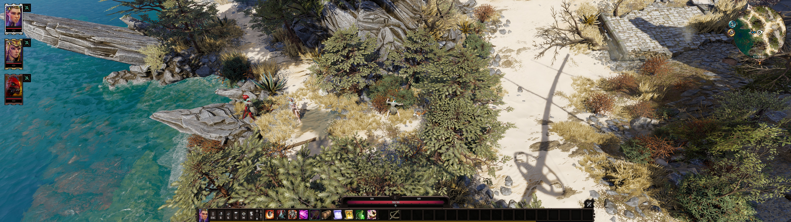
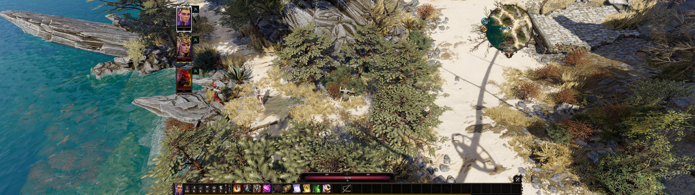

# DivinityCenteredHUD

> **Work in progress.** Tested on Divinity: Original Sin 2 – Definitive Edition (Steam) at 5120x1440 (32:9) with Norbyte's Script Extender and Epip v1075 installed. Issues and reports from other resolutions, and from setups without Epip, are welcome.

A client-side mod that lets you move the **party portraits** and the **minimap** anywhere on screen. On ultrawide and super-ultrawide displays these sit at the far left and right edges; this mod lets you pull them in toward the centre of your view and remembers where you put them.

In-game the mod is called **Divinity Centered HUD**.

## Before / After

Vanilla on a 5120x1440 (32:9) display. The portraits are pinned to the far left and the minimap to the far right:



With the mod. Portraits and minimap moved in to frame the centre of the screen:



## Download

The latest release is on the [Releases page](https://github.com/kotsaris/DivinityCenteredHUD/releases). Each release has a single file, `CenteredHUD.pak`. A rolling **Latest build** pre-release tracks `main`.

## Requirements

- Divinity: Original Sin 2 – Definitive Edition
- [Norbyte's Script Extender](https://github.com/Norbyte/ositools/releases) (v60 or later)

[Epip](https://www.pinewood.team/epip/) is **not** required. If it is installed, the mod's messages also appear as Epip's on-screen notifications; otherwise they go to the Script Extender console.

## Install

1. Put `CenteredHUD.pak` into
   ```
   Documents\Larian Studios\Divinity Original Sin 2 Definitive Edition\Mods\
   ```
2. In the game's main menu, open **Mods** and enable **Divinity Centered HUD**.
3. For a Game Master campaign, also add it to that campaign's mod list.

Uninstalling restores the vanilla layout: the mod only moves UI elements at runtime and changes no game files.

## Usage

Load into the game, then:

| Keys | Action |
|---|---|
| **Ctrl+Shift+P** | Pick up the party portraits; they follow your mouse |
| **Ctrl+Shift+M** | Pick up the minimap |
| **Left-click** (or the same hotkey again) | Drop the panel and save its position |
| **Right-click** | Cancel; the panel returns to where it was |
| **Backspace** (while moving) | Reset just that panel to its vanilla position |
| **Ctrl+Shift+Backspace** or **Ctrl+Shift+O** | Reset all panels to their vanilla positions |

The clicks used to drop or cancel are blocked from reaching the game, so they won't move your character.

Positions are saved per machine in `Documents\Larian Studios\Divinity Original Sin 2 Definitive Edition\Osiris Data\CenteredHUD.json` and restored every session. If you lower your resolution, panels are kept at least partly on-screen.

Each pickup and drop also prints a diagnostic line, prefixed `[CenteredHUD]`, to the Script Extender console and log. Include those lines when reporting a problem.

## Known limitations

- If you use Epip: its portrait scrollbar, for parties larger than four, only responds near the left edge of the screen and does not follow moved portraits.
- The portraits can be moved right only as far as roughly the middle of a 32:9 screen. Past that, the game's portrait UI area ends and they get clipped.
- Keyboard and mouse only. Controller UIs are not handled.

## How it works

Neither panel can be moved through the game's normal UI positioning: the engine keeps both pinned to their screen corner. The portraits are moved by offsetting the content of their full-width UI. The minimap UI is re-pinned to the top-left and widened to the full screen first, so the minimap can be moved without being cut off. Full details, including the dead ends, are in [FINDINGS.md](FINDINGS.md).

## Development

```
src/                 Package root; becomes the .pak as-is
  Mods/CenteredHUD_<uuid>/
    meta.lsx                         Mod metadata (name, version)
    OsiToolsConfig.json              Script Extender config (Lua feature flag)
    Story/RawFiles/Lua/BootstrapClient.lua   The whole mod
tools/
  build.py           Version checks, packs src/ into dist/CenteredHUD.pak, verifies the round-trip
  lspk.py            Minimal LSPK v13 package reader/writer (no external dependencies)
  deploy.ps1         Build and copy into the game's Mods folder (refuses while the game runs)
  swfinspect.py      Lists named element placements in a .swf; used to investigate vanilla UIs
docs/                README screenshots
```

```powershell
python tools/build.py        # -> dist/CenteredHUD.pak
.\tools\deploy.ps1           # build + install into Documents\...\Mods
```

Only Python 3 is needed to build. No LSLib or Divine.exe is required.

**Releasing:** bump `local VERSION` in `BootstrapClient.lua` and the ModuleInfo `Version` in `meta.lsx` together; `build.py` fails if they disagree. The encoding is `major<<28 | minor<<24 | revision<<16 | build`, so 1.0.0.0 is `268435456`. Push to `main` to refresh the **Latest build** pre-release, and push a `vX.Y.Z` tag to publish a versioned release. The workflow rejects a tag that doesn't match the version.

## Credits

- **[Script Extender](https://github.com/Norbyte/ositools)** by Norbyte. It provides the Lua runtime, raw input and UI APIs the mod is built on.
- **[Epip](https://github.com/PinewoodPip/EpipEncounters)** by PinewoodPip. The mod began as an Epip add-on, and several techniques come from studying Epip's source: blocking a key from the game by rewriting its raw input ID, and moving the portraits by offsetting the portrait UI's contents, as Epip's scrollable portraits do. No Epip code is included.
- **[LSLib](https://github.com/Norbyte/lslib)** by Norbyte. Its implementation of Larian's package format was the reference for `tools/lspk.py`. No LSLib code is included.
- **Larian Studios**, for Divinity: Original Sin 2.

## License

MIT. See [LICENSE](LICENSE). This covers this repository only; the Script Extender, Epip and the game have their own terms.
